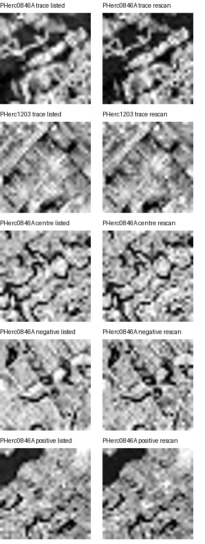

# Paired CT surfaces for PHerc. 846A and PHerc. 1203

A papyrus surface traced in a whole-scroll CT can be hard to locate in a partial scan taken at higher resolution. This repository maps between the 9.362 µm and 2.403 µm acquisitions of two Herculaneum scrolls. The ten native TIFXYZ meshes cover five paired regions. Corresponding rows and columns identify the same estimated physical location, so a reader can compare scan contrast on the two volumes.

## Open a pair

Choose a surface from the [mesh index](tifxyz/index.json). In VC3D, open the volume named there and load the matching surface directory. For example, load `tifxyz/PHerc1203/trace-listed` on the whole-scroll scan and `trace-rescan` on the higher-resolution scan. Each mesh stores level-zero voxel coordinates. Its nominal grid spacing is 38.4 µm.



The reference traces originate in ketchupbyheinz’s public scroll survey. The three additional PHerc. 846A pairs trace nearby CT density ridges. These can switch sheets where adjacent layers touch. The local correction covers only its calibrated reference patch. Use the global transform elsewhere and check alignment against the scan. [Data credits and earlier registration work](SOURCES.txt)

## Measured accuracy

Each primary patch used five landmarks to fit a correction and withheld four. The table reports median displacement against the withheld CT landmark matches. The baseline uses this study’s fitted global affine transform.

| Reference patch | Global affine | With local correction |
| --- | ---: | ---: |
| PHerc. 846A | 66.7 µm | 4.1 µm |
| PHerc. 1203 | 16.2 µm | 3.7 µm |

The follow-up tested 40 planned sites. At the 37 sites that passed the matching and error checks, median displacement across 74 withheld landmarks fell from 61.1 to 3.6 µm. Three sites failed the registration checks. These are errors relative to image matches. They do not measure the uncertainty of the landmarks themselves. [Per-site measurements, including failures](extended/heldout-comparison.json)

The official Vesuvius reader reopened all ten files, preserving their masks and 540,556 valid vertices. Sampling each exported reference surface directly from its public CT reproduced the four archived 32 × 32 patches to within one 8-bit intensity level. These tests assess coordinate transfer. Identification of previously unread text is still open. [CT checks](tifxyz/live-ct/verification.json)

## Reproduce the checks

For coordinate conversion and the offline accuracy tests, install NumPy 1.24 or newer. The TIFXYZ commands also need SciPy, Pillow and the Vesuvius Python library. The tested library revision is listed in [the source credits](SOURCES.txt).

```sh
python verify.py
python extended/summarize.py
python map_points.py surface PHerc0846A 384 384
python map_points.py forward PHerc1203 9488 4529 3405
python build_surfaces.py rebuilt-meshes
python render_tifxyz.py tifxyz/PHerc1203/trace-rescan preview.png --level 2
```

The coordinate commands take voxel centres in z, y, x order. Surface locations use row, column. To transfer another whole-scroll mesh, run the command below and choose an unused output directory. Only the part inside the rescan bounds is retained.

```sh
python transfer_tifxyz.py PHerc1203 original-tifxyz new-rescan-tifxyz
```

To reproduce a pilot's local correction on the matching archived grid, use its atlas origin and grid steps. The converter checks agreement with the source trace before applying the correction.

```sh
python transfer_tifxyz.py PHerc1203 tifxyz/PHerc1203/trace-listed new-local-tifxyz --pilot-grid 0 0 4 4
```

## Attribution and license

Karan Saptarshi used OpenAI Codex to implement and test the coordinate transfer. Original Python code is released under the [MIT License](LICENSE). Coordinates, meshes, scan-derived images and measurement data are released under [CC BY-NC 4.0](https://creativecommons.org/licenses/by-nc/4.0/) with the upstream attributions in [SOURCES.txt](SOURCES.txt).
